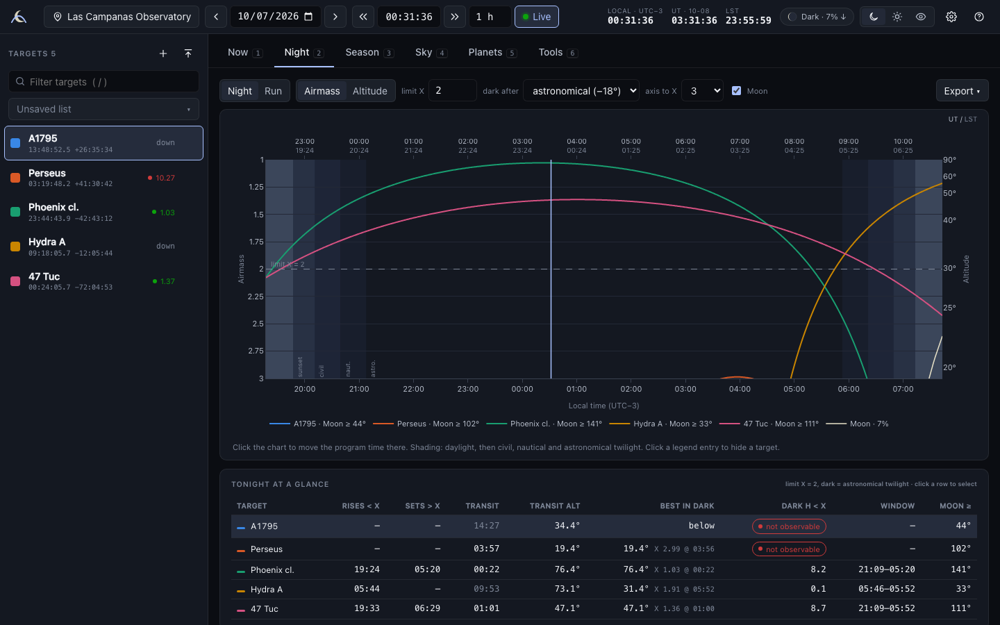

# artairmass

*A modern, offline-first observation planner — the spiritual successor to John Thorstensen's
JSkyCalc, built on astropy.* (Say it like "Artemis".)

artairmass runs a small local web server and opens in your browser. Everything except
name look-ups and finder-chart images works with the network unplugged, which is the point:
it is meant to be trusted at the telescope.



## Install

Python ≥ 3.10.

```bash
git clone <this repo> artairmass && cd artairmass
python -m venv .venv && source .venv/bin/activate
pip install -e .            # add [dev] for tests: pip install -e ".[dev]"
artairmass                  # starts the server and opens your browser
```

Options: `artairmass --app` opens a chromeless app window (Chrome/Edge/Brave/Chromium),
`--no-browser`, `--port 8765`, `--host 0.0.0.0` (e.g. over an SSH tunnel to a summit machine).

```bash
artairmass selftest         # offline sanity check of the install
artairmass update-data      # refresh Earth-orientation (IERS) data when you are online
```

## What it does

| Tab | What you get |
|---|---|
| **Now** | Everything in JSkyCalc's main window for the selected target and program time: airmass (hero), alt/az, HA, parallactic angle, LST (apparent & mean), ICRS / mean-of-date / apparent coordinates, galactic & ecliptic, constellation, parallax factors, Sun & sky state, zenith twilight, Moon phase/illumination/position, Moon–target angle, moonlit sky brightness (Krisciunas & Schaefer 1991), JD/MJD, **BJD_TDB**, JSkyCalc's UTC-based BJD, HJD, light time, barycentric RV correction, planet-proximity warnings. Edit RA/Dec/equinox in place. |
| **Night** | Interactive airmass plot for the visible targets: inverted airmass axis (or altitude) labelled in altitude on the right, local time below and UT + LST above, civil/nautical/astronomical twilight shading, Moon curve, airmass-limit line, Moon separation in the legend, unified hover, click to set the time. Per-target summary (rise/set at the limit, transit + meridian altitude, best altitude in dark, dark hours under the limit, window, min Moon separation), nightly almanac, JSkyCalc hourly table. **Run** mode for multi-night observing runs. Export PNG/PDF/SVG (matplotlib, publication quality; colour or B&W) and CSV. |
| **Season** | Best time of year: hours per night above your airmass/altitude limit in dark time, with Moon constraints (dark / grey / bright / custom illumination + minimum separation), proposal semesters shaded (A = Feb–Jul, B = Aug–Jan), midnight-transit date, plain-language advice and which semester type to propose for; targets × months heatmap for whole lists; JSkyCalc's seasonal table (each new & full Moon). |
| **Sky** | All-sky alt-az chart: bright stars (V ≤ 5), planets, Moon drawn with the correct phase and orientation, targets, meridian/equator/hour-angle arcs, airmass circles, sky colour following the Sun, clock. JSkyCalc's keys: click/`s` select, `c` new target at cursor, `h` nearest bright star, `z`/`o`/`p`/`r` zoom & pan, `f`/`b` step time, `w` open URL. |
| **Planets** | Planet table (RA/Dec/HA/alt/airmass/proximity), click to make one the target. |
| **Tools** | Slit position-angle planner (refraction-weighted optimum over an exposure, cross-slit factor plot) · coordinate converter (equatorial/galactic/ecliptic, B1950, of date) · finder charts from CDS HiPS (DSS2, 2MASS, Pan-STARRS, DES, SDSS, unWISE) with name, coordinates, scale bar and compass, PNG download or send to a running ds9 · LST ranges for radio/mm arrays · solar-elongation windows for JWST/HST/Chandra (approximate presets). |

**Target lists.** Paste, upload or drag-and-drop almost anything: CSV/TSV/semicolon/pipe/
whitespace, header rows (columns found by name), JSkyCalc object lists (including mixed
space/comma lines and URLs), SIMBAD/NED/VizieR exports, IPAC tables, ds9 region files;
sexagesimal with colons, spaces, letters or ° ′ ″; decimal degrees or hours; per-row equinox
(J/B); proper motions; galactic l, b; names only (resolved through CDS Sesame and cached).
A preview shows how every line was read; ambiguities (e.g. a decimal RA ≤ 24 that could be
hours or degrees) are flagged, never silently guessed, and rows can be fixed inline. Lists
are saved by name, sortable by RA or name, exportable to CSV or JSkyCalc format.

**Sites.** 42 built-in observatories (Las Campanas, Cerro Pachón, CTIO, Paranal, La Silla,
Chajnantor/ALMA, Narrabri/ATCA, MRO/ASKAP, Mauna Kea, Kitt Peak, Mt Hopkins, Palomar, SALT,
Roque de los Muchachos, …) plus your own, with IANA time zones so daylight saving is right.

**Comfort.** Dark, light and **red night-vision** themes (`r`), keyboard-first (`?` lists
everything: `n` now, `f`/`b` step, `[`/`]` night, `1`–`6` tabs, `j`/`k` targets, `/` filter),
tooltips that define every quantity and its convention, settings persisted.

## Accuracy & conventions

* Astrometry, ephemerides (built-in ERFA model) and barycentric corrections come from
  astropy. A fast interpolating engine handles nights and years; it is tested against
  astropy's full `AltAz` chain to < 1″.
* By default altitudes are **geometric** and airmass is **Hardie (1962)** — JSkyCalc's
  conventions. Young (1994) and sec z are available in Settings.
* "Dark" defaults to astronomical twilight (Sun below −18°); nautical is selectable.
* The night of date D runs from local noon on D to local noon on D+1.
* **Validated against JSkyCalc itself** — JSkyCalc's own classes were run headless over 27
  site/date cases (both hemispheres, DST changes, near-pole and near-horizon targets) and
  compared quantity by quantity: see [`validation/VALIDATION.md`](validation/VALIDATION.md).
  Typical agreement: rise/set and twilight ≤ 6 s; LST ≤ 0.12 s; alt/az 10–30″ (JSkyCalc
  omits nutation and aberration); BJD ≤ 0.03 s; RV correction ≤ 7 m/s.

## Offline behaviour

* astropy never touches the network on its own. Earth-orientation data come from the
  newest of the bundled `astropy-iers-data` table or one fetched by `artairmass update-data`.
  If they are stale you get a banner, not an error (worst case ~1 s in LST).
* Name resolution and finder-chart images are the only network features; they fail with a
  clear message, and resolved names are cached in your user cache directory.

Your settings, sites and lists live in the platform config directory
(`~/Library/Application Support/artairmass` on macOS, `~/.config/artairmass` on Linux);
override with `ARTAIRMASS_CONFIG_DIR` / `ARTAIRMASS_CACHE_DIR`.

## Development

```bash
pip install -e ".[dev]" && python -m playwright install chromium
pytest                                   # 168 tests incl. JSkyCalc comparison
python scripts/uicheck_full.py out/      # click through every feature (15 scenarios)
python scripts/uicheck.py out/           # drive the real UI headless, screenshots + console errors
python scripts/uicheck_import.py out/    # list import flow
python scripts/uicheck_tools.py out/     # tools tab
validation/run_jskycalc.sh               # regenerate JSkyCalc reference values (needs Java 8 jjs + the jar)
```

Layout: `src/artairmass/core` (astronomy), `io` (parser, resolver), `api` (FastAPI),
`plots` (matplotlib), `web` (Preact + htm + Plotly, vendored — no build step).
`FEATURES.md` is the JSkyCalc feature inventory; `PLAN.md` the architecture.

## Credits

* **JSkyCalc** by John Thorstensen (Dartmouth) — the model for this program. Ported from it:
  the Krisciunas & Schaefer moonlight and zenith-twilight formulae and the seasonal-table
  layout. Its classes serve as the validation oracle.
* astropy, ERFA, numpy, scipy, matplotlib, FastAPI; Plotly.js, Preact, htm.
* Yale Bright Star Catalogue (Hoffleit & Warren 1991, via CDS); CDS Sesame and hips2fits.
