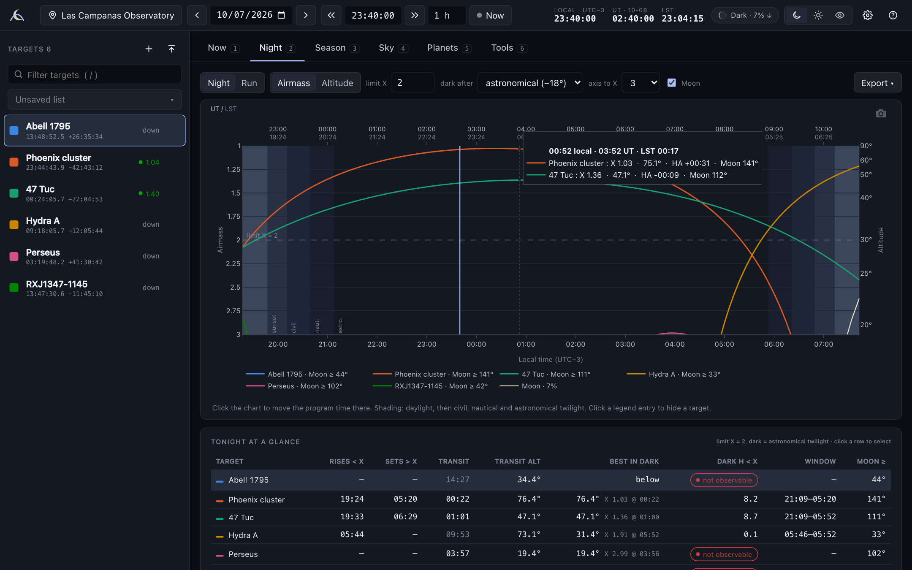
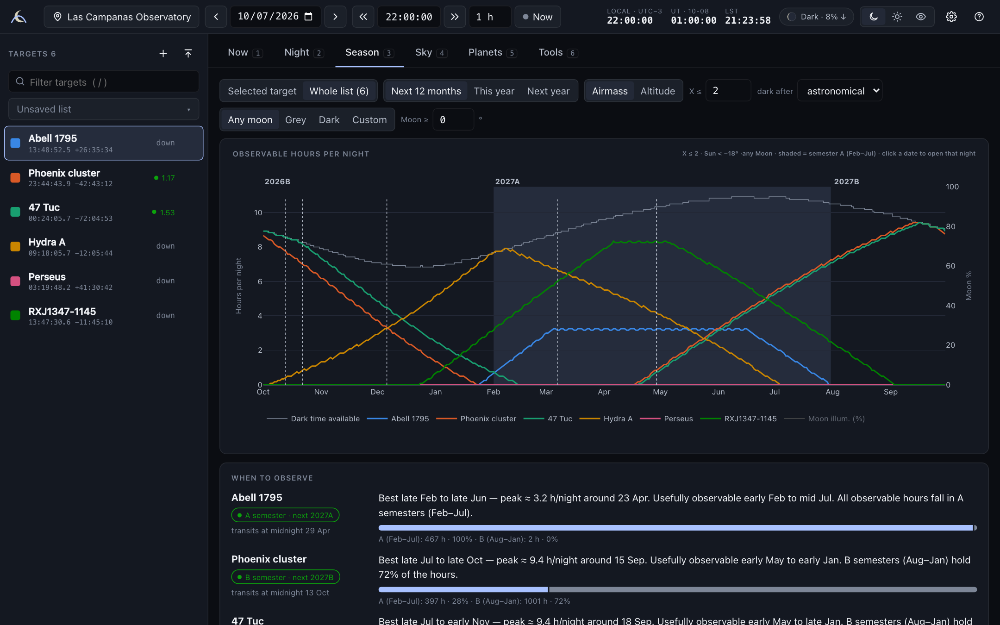
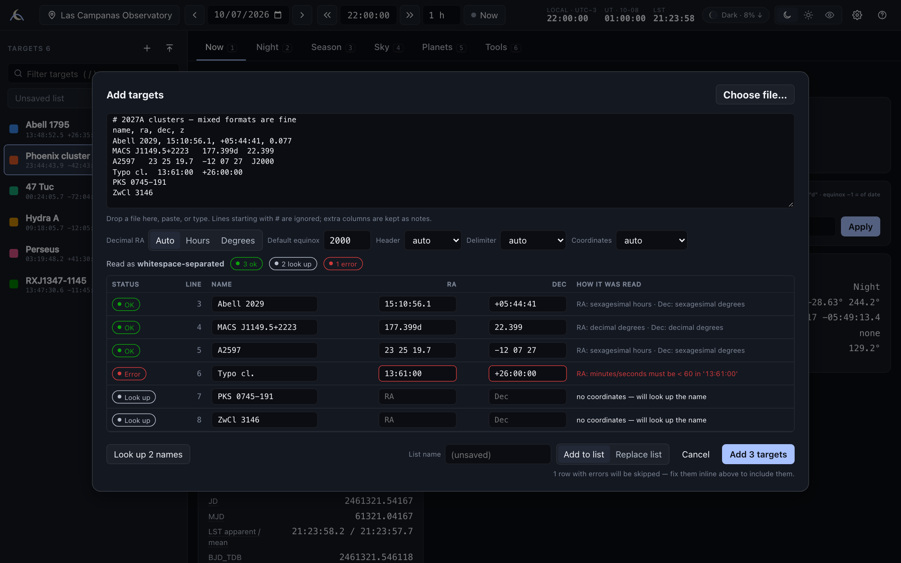
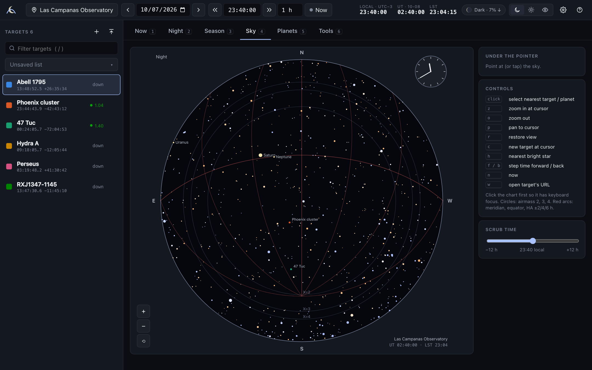
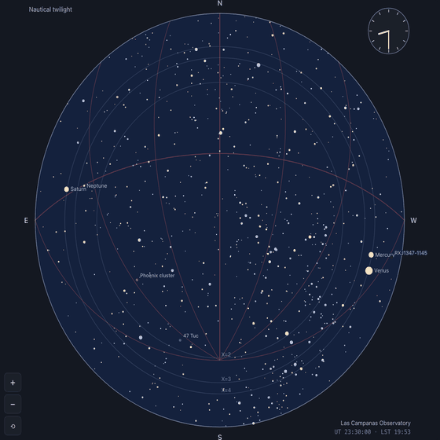
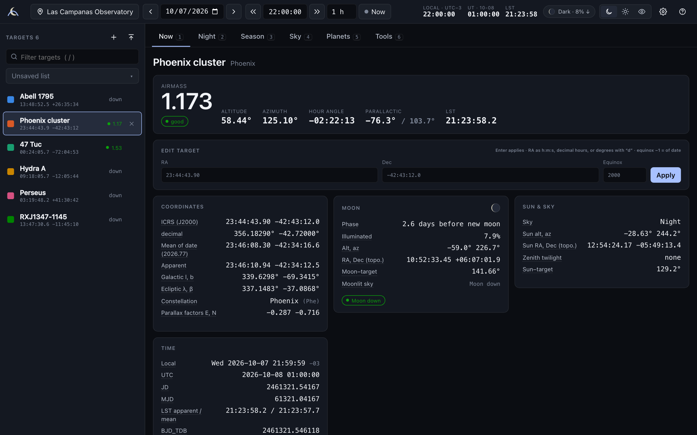
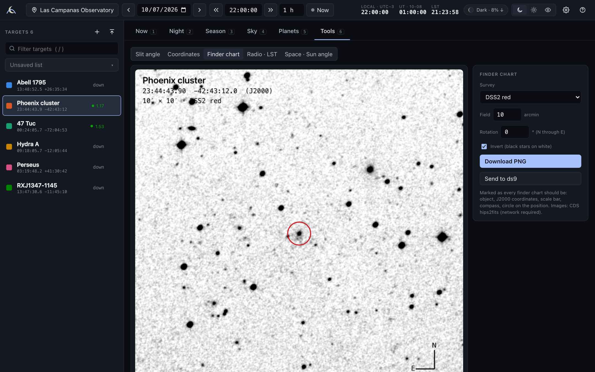
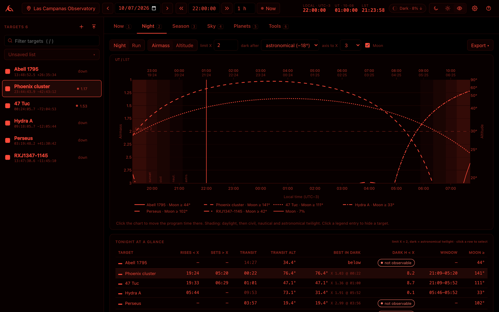
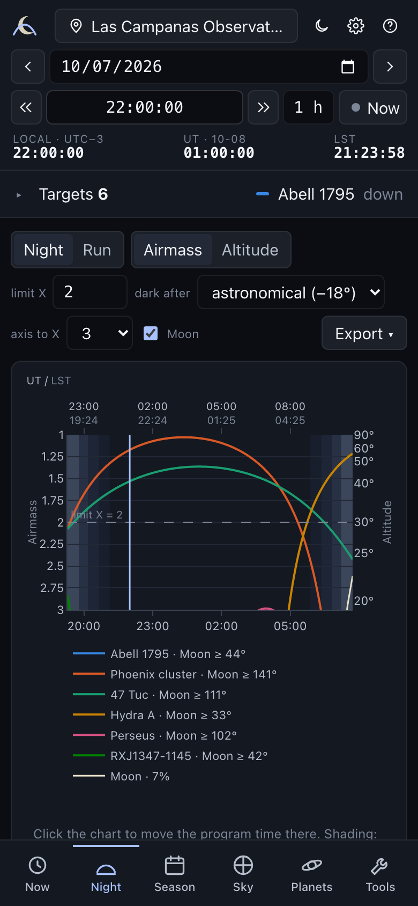
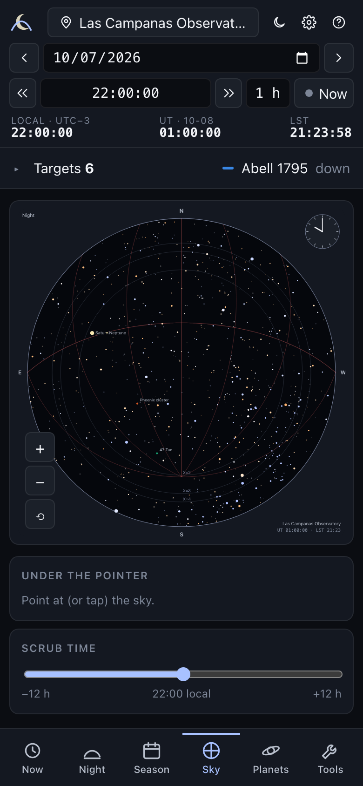

<div align="center">


# artairmass

**Plan observations without the guesswork.** Airmass plots, nightly almanacs, best time of year
and an all-sky chart for any observatory. Offline-first, validated against JSkyCalc, and
pleasant to use at 3 a.m. in red light.

*(say it like "Artemis")*

[](https://github.com/msc92/artairmass/actions/workflows/ci.yml)
[](LICENSE)

[](validation/VALIDATION.md)



</div>

## Quick start

```bash
pipx install git+https://github.com/msc92/artairmass     # or: pip install git+https://github.com/msc92/artairmass
artairmass                                              # opens in your browser
```

That's it. No accounts and no cloud. It runs on your laptop (or on a summit machine over SSH),
and everything except name look-ups and finder-chart images works with the network unplugged.

<details>
<summary>Other ways to run it</summary>

```bash
artairmass --app                     # chromeless app window (Chrome / Edge / Brave / Chromium)
artairmass --no-browser --port 8765  # just the server, e.g. behind an SSH tunnel
artairmass selftest                  # offline sanity check
artairmass update-data               # refresh Earth-orientation (IERS) data while online
```

From a clone: `pip install -e .` (add `".[dev]"` for the test tools).
</details>

## Why another planner?

[JSkyCalc](validation/VALIDATION.md#method) by John Thorstensen has been many observers' companion
for two decades: fast, trustworthy, a little cryptic. artairmass keeps everything it does
(the inventory is in [FEATURES.md](FEATURES.md)) and adds what planning a modern proposal or an
observing run needs:

- **Paste any target list.** CSV, TSV, SIMBAD/NED/VizieR exports, IPAC tables, ds9 regions,
  JSkyCalc lists, names only. You see how each line was read, and it **never guesses silently**.
- **Airmass plots worth putting in a proposal**, as PNG, PDF or SVG.
- **Best time of year** in plain language, with proposal semesters and Moon constraints.
- **One app for optical, radio and space**: twilight-aware nights, LST ranges for ALMA/ATCA,
  Sun-angle windows for JWST/HST/Chandra.
- **Built on astropy** and checked number-by-number against JSkyCalc itself.

## A tour

### Tonight
The **Night** view (above) plots every visible target with an inverted airmass axis, labelled in
altitude on the right. Local time runs along the bottom with UT and LST on top. Twilight is
shaded, and the Moon's altitude and per-target Moon separation are shown. Hover for a full
readout, click to move the clock there, and switch to **Run** mode for a multi-night observing
run. Each target gets a summary: when it crosses your airmass limit, its transit and meridian
altitude, its best altitude in the dark, how many dark hours it's observable, and how close the
Moon gets.

### When should I propose?


For each target, artairmass counts the hours it's observable every night of the year (above
your airmass limit, in dark time, under your Moon constraints). It marks the date the target
transits at midnight, shades semesters A and B, and says it in words: *"Best late Jul to late
Oct — peak ≈ 9.4 h/night around 15 Sep. B semesters (Aug–Jan) hold 72% of the hours."* Whole
lists get a targets × months heatmap. JSkyCalc's classic seasonal table is there too.

### Getting targets in


Drop a file anywhere on the window, or paste. Each line gets a status and an explanation.
Typos can be fixed inline. Bare names are resolved through CDS Sesame (SIMBAD → NED → VizieR)
and cached. Lists are saved by name and export to CSV or JSkyCalc format.

### The sky, right now
<table><tr>
<td width="58%"></td>
<td></td>
</tr></table>

A JSkyCalc-style all-sky chart: bright stars coloured by spectral type, planets, the Moon drawn
with the right phase and orientation, your targets, the meridian, the equator, hour-angle arcs
and airmass circles. JSkyCalc's keyboard commands work: click or `s` to select, `c` for a new
target at the cursor, `h` for the nearest bright star, `z`/`o`/`p`/`r` to zoom and pan, `f`/`b`
to step time.

### Everything about one target, one moment


Airmass, alt/az, hour angle, parallactic angle, LST (apparent and mean), ICRS / mean-of-date /
apparent / galactic / ecliptic coordinates, the Moon and moonlit-sky brightness (Krisciunas &
Schaefer 1991), zenith twilight, planet-proximity warnings, and **BJD_TDB, HJD and the barycentric
RV correction**. Every quantity has a hover definition stating its convention.

### Tools
<table><tr>
<td width="50%"></td>
<td>

- **Finder charts** from DSS2, 2MASS, Pan-STARRS, DES, SDSS or unWISE, marked up the way every
  finder should be (name, J2000 coordinates, scale bar, compass). Download as PNG or send to ds9.
- **Slit position angle**: the refraction-weighted optimum over your exposure.
- **Coordinate converter**: equatorial ⇄ galactic ⇄ ecliptic, B1950, of date.
- **Radio**: LST ranges above an elevation limit (ALMA, ATCA, ASKAP, VLA…).
- **Space**: solar-elongation windows (JWST 85°–135°; HST and Chandra presets marked approximate).

</td></tr></table>

### At the telescope, and on your phone
<table><tr>
<td width="56%"></td>
<td width="22%"></td>
<td width="22%"></td>
</tr></table>

Press `r` for **red night-vision mode**: pure red on black, with curves told apart by dash
pattern, never by hue. It's keyboard-first (`?` lists every shortcut), and the layout adapts to
phones and tablets (a target drawer, a bottom tab bar, touch zoom on the sky chart).
Light and dark themes are there for the daytime.

## Can I trust the numbers?

JSkyCalc's own compiled classes were run headlessly over **27 site/date cases × 12 targets**:
both hemispheres, every 2026 DST change, solstices, near-pole and 3°-above-the-horizon targets.
Each quantity was compared with artairmass. Highlights (full table and explanations in
**[validation/VALIDATION.md](validation/VALIDATION.md)**):

| Quantity | Agreement with JSkyCalc | Why any difference |
|---|---|---|
| Sunset / sunrise / twilights / moonrise | ≤ 6 s | numerical root-finding vs analytic iteration |
| Sidereal time | ≤ 0.12 s | JSkyCalc ignores UT1−UTC |
| Altitude, azimuth, hour angle | 10–30″ | JSkyCalc omits nutation and aberration |
| Airmass (Hardie), sky brightness, zenith twilight | identical (10⁻¹²) given the same inputs | same formulae |
| Barycentric JD / RV correction | ≤ 0.03 s / ≤ 7 m/s | JSkyCalc's low-order barycentre model |
| Seasonal table | identical dates; ≤ 0.07 h | sampled vs analytic |

Independently, the fast plotting engine is tested against astropy's full `AltAz` chain to < 1″,
and the almanac against astroplan. **168 automated tests** plus a headless-browser click-through
of every feature run in CI.

**Conventions** (changeable in Settings): geometric altitude and Hardie airmass, as in JSkyCalc;
"dark" means the Sun is below −18°; the night of date D runs from local noon on D to local noon
on D+1. Time zones come from the IANA database, so DST is always right.

## Sites

42 observatories are built in: Las Campanas, Cerro Pachón, CTIO, Paranal, Armazones, La Silla,
Chajnantor (ALMA), Narrabri (ATCA), Parkes, Siding Spring, MRO (ASKAP/MWA), Sutherland (SALT),
MeerKAT, Mauna Kea, Haleakalā, Kitt Peak, Mt Hopkins, Mt Graham, Lowell, Palomar, Lick, McDonald,
Apache Point, VLA, Green Bank, Roque de los Muchachos, Teide, Calar Alto, IRAM, NOEMA, Hanle, and
more. Add your own in the site menu. Missing a big one? [Open a PR](CONTRIBUTING.md).

## Contributing

Bug reports from real observing runs are gold, especially **"this number looks wrong"**: there's
an issue template for exactly that. New sites, list formats the parser doesn't know yet, UI
polish and new tools are all welcome. See **[CONTRIBUTING.md](CONTRIBUTING.md)** for setup, the
checks to run, and the few ground rules: accuracy first, offline first, never guess silently.

```bash
git clone https://github.com/msc92/artairmass && cd artairmass
pip install -e ".[dev]" && python -m playwright install chromium
pytest && python scripts/uicheck_full.py /tmp/ui
```

## Acknowledgements

artairmass exists because of **JSkyCalc** by John Thorstensen (Dartmouth College), which it
reimplements and validates against. It is built on [astropy](https://www.astropy.org) and ERFA,
numpy, scipy, matplotlib and FastAPI; the UI uses Plotly.js, Preact and htm. Star positions come
from the Yale Bright Star Catalogue (Hoffleit & Warren 1991). Name resolution and finder images
use CDS services (Sesame, hips2fits). See [THIRD_PARTY_NOTICES.md](THIRD_PARTY_NOTICES.md).

Released under the [BSD 3-Clause License](LICENSE).
